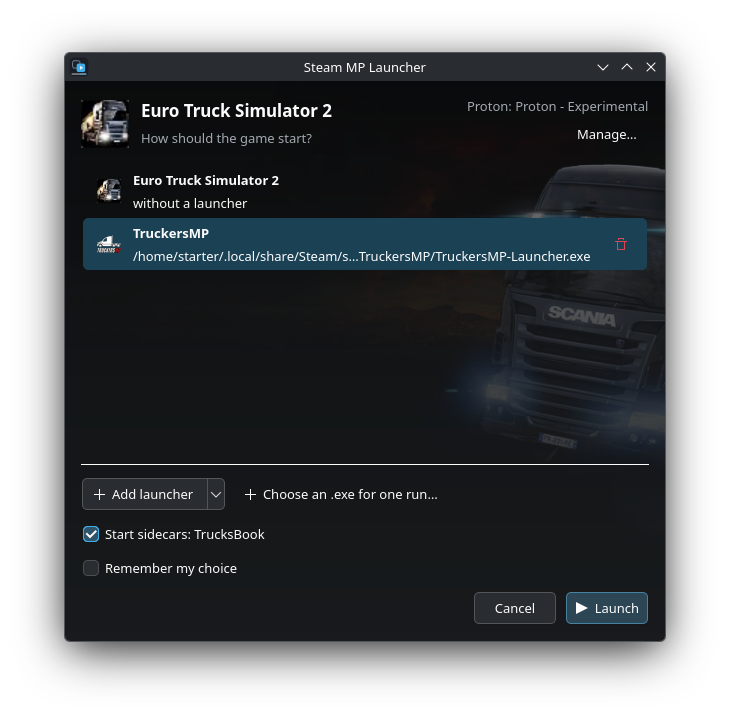

# Steam MP Launcher

Start TruckersMP, TrucksBook and other multiplayer tools instead of the game
itself — straight from Steam, on Linux.



## What it does

- **Pick what starts.** The game, TruckersMP, or any `.exe` you add. It can
  remember your choice and show a short countdown before starting.
- **Run sidecars.** Extra programs such as TrucksBook start with the game and
  close with it. One checkbox turns them off for a launch.
- **Install launchers.** A small wizard finds the TruckersMP or TrucksBook
  setup in Downloads, runs it in the game's prefix, sets the game path and
  adds the launcher to the list.
- **Manage your lists.** Launchers and sidecars can be shared by all games or
  kept for one game. Rename, relink or remove entries anytime.
- **Choose Proton.** Pick which Proton build runs the game.
- **Control the session.** A tray icon lets you start another program or stop
  the game.
- **Open with.** Right-click an `.exe` → add it as a launcher/sidecar or run
  it once.
- **Logs and settings** live in one manager window (with the installers).

Works with any Steam game; Euro Truck Simulator 2 / American Truck Simulator
with TruckersMP is the usual setup.

## Install

One command — no system packages, no sudo (the download carries its own Qt):

```bash
curl -fsSL https://github.com/starter3xd/steam-mp-launcher/releases/latest/download/install.sh | bash
```

Then restart Steam, open the game → **Properties → Compatibility**, tick
**Force the use of a specific Steam Play compatibility tool** and choose
**Steam MP Launcher (Next)**, then press **Play**.

Prefer files? Download the `…-bundle-linux-x86_64.tar.gz` asset, unpack it and
run `./install.sh` inside. Flatpak Steam is detected automatically.

Starting ETS2 once without this tool first gives it a prefix for the
installers.

## Good to know

- Settings and lists: `~/.config/steam-mp-launcher/`
- Logs: `~/.local/state/steam-mp-launcher/logs/`
- **Cancel** stops the launch. If you prefer it to start the plain game
  instead, set **When cancelled → Run the plain game** in the manager.
- Dark mode follows your desktop (KDE, GNOME, Flatpak). To force one:
  `STEAM_MP_THEME=light` or `STEAM_MP_THEME=dark`.

## License

MIT.
